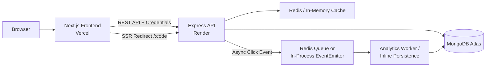

# LinkForge — URL Shortener & Click Analytics Platform

A full-stack JavaScript URL shortening and click analytics platform built as a modular monorepo with **Next.js 14**, **Express**, **MongoDB**, and **Redis** (with automatic in-memory caching and asynchronous analytics fallbacks).

- **Live App (Vercel):** https://url-shortner-theta-ruby.vercel.app
- **API Health Check (Render):** https://link-forge-efqd.onrender.com/health/ready
- **Demo Account:** `demo@linkforge.dev` / `Password123!` *(or click **Fill demo credentials** on `/login`)*

---

## Key Features

- **URL Shortening & Custom Aliases:** Generates collision-resistant 7-character Base62 short codes with unique MongoDB index retry handling, plus optional custom aliases (`3–50` chars) with reserved-slug protection.
- **Fast `302` Redirects & Expiration:** Resolves short codes via a cache-first lookup (`Redis` or in-memory fallback) with TTL clamped to link expiration, returning `410 Gone` for expired links and `404` for unknown/disabled codes.
- **Click Analytics:** Records click timestamps, referrer host, device type, and browser family asynchronously without blocking redirects, visualized via `7d`, `30d`, and `90d` time-series charts and breakdowns.
- **Dashboard & Account Management:** Responsive top-navbar layout with a user dropdown menu, search, status filtering (`all`, `active`, `disabled`, `expired`), pagination, link editing, status toggles, and account deletion.
- **Security & Validation:** Shared Zod schemas (`@linkforge/shared`) block dangerous schemes such as `javascript:` and `data:`, paired with `bcryptjs` password hashing, JWT access tokens, `HttpOnly` refresh cookies, Helmet headers, CORS allowlisting, and rate limiting.
- **Observability:** Structured JSON logging via Pino, Prometheus `/metrics` endpoint, and `/health/live` + `/health/ready` probes.

---

## Tech Stack

| Layer | Technologies |
| :--- | :--- |
| **Frontend** | Next.js 14 (App Router), React 18, Tailwind CSS, TanStack React Query, Zustand, React Hook Form, Zod, Recharts, Lucide Icons |
| **Backend API** | Node.js (ES Modules), Express, Mongoose, `ioredis`, JSON Web Tokens, `bcryptjs`, `helmet`, `express-rate-limit`, Pino, `prom-client`, `ua-parser-js` |
| **Database & Cache** | MongoDB Atlas, Redis (with automatic in-memory cache fallback & in-process async click persistence when `REDIS_URL` is unset or `DISABLE_REDIS_QUEUE=true`) |
| **Worker** | Standalone Node.js worker (`@linkforge/worker`) polling `linkforge:queue:clicks` when Redis queueing is enabled |
| **Testing & CI** | Vitest, Supertest, GitHub Actions |
| **Hosting** | Vercel (Frontend), Render (Backend API), MongoDB Atlas (Database) |

---

## Architecture Overview



For deeper architecture notes, see [systemdesign.md](./systemdesign.md), [frontend.readme.md](./frontend.readme.md), [docs/architecture.md](./docs/architecture.md), and [docs/api.md](./docs/api.md).

---

## Repository Structure

```text
├── .github/workflows/ci.yml        # GitHub Actions CI pipeline
├── apps/
│   ├── api/                        # Express REST API & redirect service
│   │   ├── src/
│   │   │   ├── config/             # Environment config & URL normalization
│   │   │   ├── infrastructure/     # MongoDB models, Redis cache, event publisher
│   │   │   ├── middleware/         # Auth, rate limiters, validation, error handler
│   │   │   ├── modules/            # auth, links, redirect, analytics
│   │   │   ├── observability/      # Pino logger & Prometheus metrics
│   │   │   ├── app.js
│   │   │   └── server.js
│   │   └── tests/api.test.js       # Vitest + Supertest integration suite
│   ├── web/                        # Next.js 14 frontend (App Router, JS/JSX)
│   │   ├── app/                    # /, /login, /register, /dashboard, /[code]
│   │   ├── components/             # layout, links, analytics, ui, providers
│   │   ├── lib/                    # Axios client, API modules, Zustand auth store
│   │   ├── jsconfig.json
│   │   ├── tailwind.config.js
│   │   └── vercel.json
│   └── worker/                     # Background Redis queue worker
│       ├── src/index.js
│       └── tests/worker.test.js
├── docs/                           # API, architecture, and ADR docs
├── packages/shared/                # Shared Zod schemas & constants (@linkforge/shared)
├── package.json                    # npm workspaces root
├── render.yaml                     # Render blueprint for @linkforge/api
├── systemdesign.md
└── frontend.readme.md
```

---

## API Endpoints

### Auth (`/api/v1/auth`)
| Method | Endpoint | Description |
| :--- | :--- | :--- |
| `POST` | `/api/v1/auth/register` | Create user account and issue tokens |
| `POST` | `/api/v1/auth/login` | Authenticate user and set `refresh_token` cookie |
| `POST` | `/api/v1/auth/logout` | Clear refresh cookie |
| `POST` | `/api/v1/auth/refresh` | Rotate access & refresh tokens |
| `GET` | `/api/v1/auth/me` | Get authenticated user profile |
| `PATCH` | `/api/v1/auth/profile` | Update name or email |
| `POST` | `/api/v1/auth/change-password` | Update password |
| `DELETE` | `/api/v1/auth/account` | Delete account, links, and click records |

### Links & Redirects
| Method | Endpoint | Description |
| :--- | :--- | :--- |
| `POST` | `/api/v1/links` | Create a short link or custom alias |
| `GET` | `/api/v1/links` | List user links (paginated, search & status filters) |
| `GET` | `/api/v1/links/:id` | Fetch single link details |
| `PATCH` | `/api/v1/links/:id` | Update destination URL, title, or expiry |
| `PATCH` | `/api/v1/links/:id/status` | Enable or disable a link |
| `DELETE` | `/api/v1/links/:id` | Delete link and analytics events |
| `GET` | `/:code` | Resolve short code and issue `302` redirect |

### Analytics & Operations
| Method | Endpoint | Description |
| :--- | :--- | :--- |
| `GET` | `/api/v1/links/:id/analytics` | Click trends, referrers, devices, browsers (`7d`, `30d`, `90d`) |
| `GET` | `/api/v1/analytics/overview` | Account-wide link and click totals |
| `GET` | `/health/live` | Liveness probe |
| `GET` | `/health/ready` | Readiness probe (MongoDB + cache status) |
| `GET` | `/metrics` | Prometheus metrics |

---

## Local Development

### Prerequisites
- **Node.js 20+** and **npm**
- **MongoDB** running locally (or a MongoDB Atlas URI)
- **Redis** *(optional — falls back automatically to in-memory cache and async local click persistence)*

### Setup & Run
```bash
# 1. Install all workspace dependencies
npm install

# 2. Configure environment variables
cp .env.example .env
# Update MONGODB_URI and JWT secrets in .env if needed

# 3. Start API, Worker, and Web dev servers concurrently
npm run dev
```

Or run services individually:
```bash
npm run dev:api       # http://localhost:4000
npm run dev:web       # http://localhost:3000
npm run dev:worker    # Background queue worker (requires Redis)
```

### Tests & Verification
```bash
# Run worker unit tests
npm run test -w @linkforge/worker

# Run API integration tests (requires MongoDB)
npm run test -w @linkforge/api

# Build / syntax-check all workspaces
npm run build
```

---

## Deployment (Vercel + Render + MongoDB Atlas)

1. **Database (MongoDB Atlas):** Create a free `M0` cluster, allow network access (`0.0.0.0/0`), and copy the `mongodb+srv://...` URI (with `/linkforge` before `?`).
2. **Backend API (Render):** Deploy using [render.yaml](./render.yaml) (`buildCommand: npm ci`, `startCommand: npm run start -w @linkforge/api`) with `NODE_ENV=production`, `DISABLE_REDIS_QUEUE=true`, `MONGODB_URI`, `JWT_ACCESS_SECRET`, `JWT_REFRESH_SECRET`, `PUBLIC_APP_URL`, and `API_BASE_URL`.
3. **Frontend (Vercel):** Import the repository with **Root Directory** set to `apps/web` (uses [apps/web/vercel.json](./apps/web/vercel.json)), and configure `NEXT_PUBLIC_API_URL` and `API_BASE_URL` pointing to your Render URL.
