# LinkForge — System Design Document

> **Version:** 1.0  
> **Date:** November 2026  
> **Status:** Authoritative design reference for the LinkForge URL shortening platform

---

## Table of Contents

1. [Requirements](#1-requirements)
2. [Capacity Estimation](#2-capacity-estimation)
3. [High-Level Architecture](#3-high-level-architecture)
4. [Component Design](#4-component-design)
5. [Data Model & Storage](#5-data-model--storage)
6. [Short Code Generation](#6-short-code-generation)
7. [Redirect Flow (Critical Path)](#7-redirect-flow-critical-path)
8. [Caching Strategy](#8-caching-strategy)
9. [Analytics Pipeline](#9-analytics-pipeline)
10. [API Design](#10-api-design)
11. [Security Design](#11-security-design)
12. [Reliability & Fault Tolerance](#12-reliability--fault-tolerance)
13. [Observability](#13-observability)
14. [Deployment Architecture](#14-deployment-architecture)
15. [CI/CD Pipeline](#15-cicd-pipeline)
16. [Scalability Roadmap](#16-scalability-roadmap)
17. [Engineering Trade-offs & ADRs](#17-engineering-trade-offs--adrs)

---

## 1. Requirements

### 1.1 Functional Requirements

| Priority | Requirement |
|----------|-------------|
| P0 | Users can register, log in, and log out |
| P0 | Authenticated users can create a short URL from a valid destination URL |
| P0 | A visitor hitting `/:code` is redirected to the destination URL |
| P0 | Short codes are unique and URL-safe |
| P1 | Users can request a custom alias instead of a random code |
| P1 | Links can have an optional expiration date |
| P1 | Users can list, update, enable/disable, and delete their links |
| P1 | Click events (count, referrer, device, browser) are recorded asynchronously |
| P2 | Users can view click trends and analytics per link |
| P2 | Account-level analytics overview |
| P2 | Health and readiness endpoints |
| P2 | Prometheus metrics endpoint |

### 1.2 Non-Functional Requirements

| Attribute | Target |
|-----------|--------|
| **Redirect latency** | p99 < 50 ms (cache hit); p99 < 200 ms (cache miss) |
| **Availability** | 99.9% uptime for redirect path |
| **Consistency** | Strong consistency for link creation; eventual consistency for analytics |
| **Durability** | Zero link data loss; analytics events at-least-once |
| **Security** | HTTPS only; no raw IP storage; no dangerous URL schemes |
| **Scalability** | Horizontal scale of API layer without redesign |
| **Observability** | Latency, error rate, and cache hit ratio always visible |

### 1.3 Out of Scope (v1)

- Custom domains per user
- QR code generation
- Password-protected links
- Multi-region deployment
- CDN integration
- Kubernetes orchestration

---

## 2. Capacity Estimation

> These are **illustrative estimates** for sizing decisions. Replace with measured data before provisioning production infrastructure.

### 2.1 Assumptions

| Parameter | Estimate |
|-----------|----------|
| Daily active users | 10,000 |
| Links created per day | 50,000 |
| Redirect requests per day | 5,000,000 |
| Read-to-write ratio | 100 : 1 |
| Average short code length | 7 characters |
| Average click event size | ~200 bytes |
| Average link document size | ~500 bytes |

### 2.2 Traffic (Redirects)

```
Peak redirect QPS  = 5,000,000 / 86,400 × 10 (peak factor) ≈ 580 req/s
Cache hit target   = 90%+
MongoDB reads/s    = 580 × 0.10 ≈ 58 req/s (cache misses only)
```

### 2.3 Storage

```
Links per year      = 50,000 × 365     = 18.25 million documents
Link storage/year   = 18.25M × 500 B   ≈ 9 GB
Click events/day    = 5,000,000
Click storage/year  = 5M × 365 × 200 B ≈ 365 GB
```

**Implication:** Click events dominate storage. TTL-based pruning or aggregation into `AnalyticsSummary` becomes important after ~6 months.

### 2.4 Cache Sizing

```
Hot links (top 10%)  ≈ 1.825 million
Size per cached val  ≈ 300 bytes
Redis memory needed  ≈ 1.825M × 300 B ≈ 547 MB → plan for 1 GB
```

---

## 3. High-Level Architecture

### 3.1 Logical Architecture

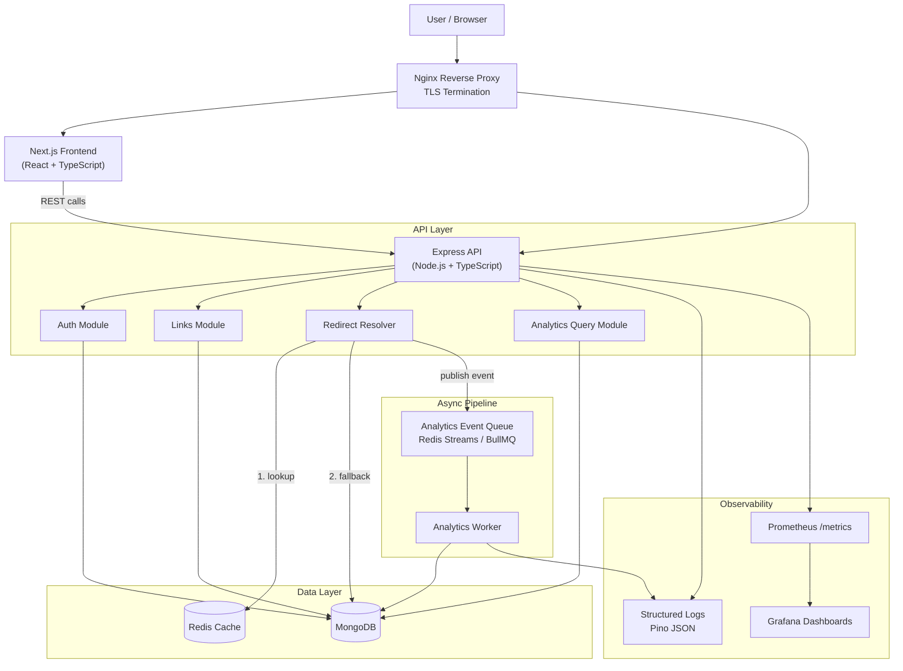

### 3.2 Component Responsibilities

| Component | Role | Technology |
|-----------|------|------------|
| **Nginx** | TLS termination, request routing, static asset serving | Nginx |
| **Next.js Frontend** | Dashboard, link management UI, analytics display | React, Next.js, TypeScript |
| **Express API** | Auth, link CRUD, redirect resolution, analytics queries | Node.js, Express, TypeScript |
| **Redirect Resolver** | Hot path: resolve code → destination with sub-50ms latency | In-process module |
| **MongoDB** | Durable source of truth for all persistent data | MongoDB 7+ |
| **Redis** | Low-latency cache for redirect lookups + event queue backing | Redis 7+ |
| **Analytics Worker** | Consumes click events, persists and aggregates analytics | Separate Node.js process |
| **Prometheus** | Scrapes and stores time-series metrics | Prometheus |
| **Grafana** | Visualizes metrics and dashboards | Grafana |

---

## 4. Component Design

### 4.1 Backend Layering

Each backend module follows a strict layered pattern to prevent logic leakage:

```
HTTP Request
    │
    ▼
┌─────────────────────────────────────────────────────────┐
│  Middleware Layer                                        │
│  (auth guard, rate limiter, request validator, logger)  │
└─────────────────────────────────┬───────────────────────┘
                                  │
                                  ▼
┌─────────────────────────────────────────────────────────┐
│  Controller                                             │
│  (parse request, call service, shape HTTP response)     │
└─────────────────────────────────┬───────────────────────┘
                                  │
                                  ▼
┌─────────────────────────────────────────────────────────┐
│  Service  (business rules & orchestration)              │
│  - validate ownership   - enforce expiry                │
│  - generate short codes - publish events                │
└─────────────────────────────────┬───────────────────────┘
                                  │
                                  ▼
┌─────────────────────────────────────────────────────────┐
│  Repository  (data access only, no business logic)      │
│  - findByCode()   - save()   - updateStatus()           │
└──────────────────┬──────────────────────┬───────────────┘
                   │                      │
                   ▼                      ▼
            MongoDB Driver          Redis Client
```

**Rules:**
- Routes never contain business logic.
- Services never build raw MongoDB queries.
- Repositories never make HTTP calls or publish events.

### 4.2 Backend Module Map

```
src/modules/
├── auth/
│   ├── auth.routes.ts       # POST /api/v1/auth/*
│   ├── auth.controller.ts
│   ├── auth.service.ts      # JWT issue/verify, password hash
│   └── auth.repository.ts   # User lookups
│
├── users/
│   ├── users.routes.ts
│   ├── users.controller.ts
│   └── users.repository.ts
│
├── links/
│   ├── links.routes.ts      # /api/v1/links
│   ├── links.controller.ts
│   ├── links.service.ts     # Create, update, ownership checks
│   ├── links.repository.ts
│   └── shortcode.service.ts # Code generation logic
│
├── redirect/
│   ├── redirect.routes.ts   # GET /:code
│   ├── redirect.service.ts  # Cache → DB → validate → emit event
│   └── redirect.repository.ts
│
├── analytics/
│   ├── analytics.routes.ts
│   ├── analytics.controller.ts
│   └── analytics.repository.ts
│
└── events/
    ├── event-publisher.ts   # Publish to Redis Streams / BullMQ
    └── event.types.ts
```

### 4.3 Analytics Worker

The worker is a separate Node.js process (separate Docker container):

```
worker/src/
├── worker.ts              # Entry point, connects to queue
├── processors/
│   └── click.processor.ts # Validate event, upsert AnalyticsSummary
├── infrastructure/
│   ├── queue-consumer.ts  # BullMQ / Redis Streams consumer
│   └── db.ts              # MongoDB connection
└── observability/
    └── metrics.ts         # Queue depth, failures counter
```

**Worker contract:**
- Pull events from queue.
- Validate event shape; drop malformed events after logging.
- Upsert `AnalyticsSummary` using `findOneAndUpdate` with `upsert: true` for idempotency.
- Retry transient DB errors with exponential backoff (max 5 attempts).
- After max retries, move to dead-letter queue (DLQ) and emit `worker.failure` metric.

---

## 5. Data Model & Storage

### 5.1 Collections Overview

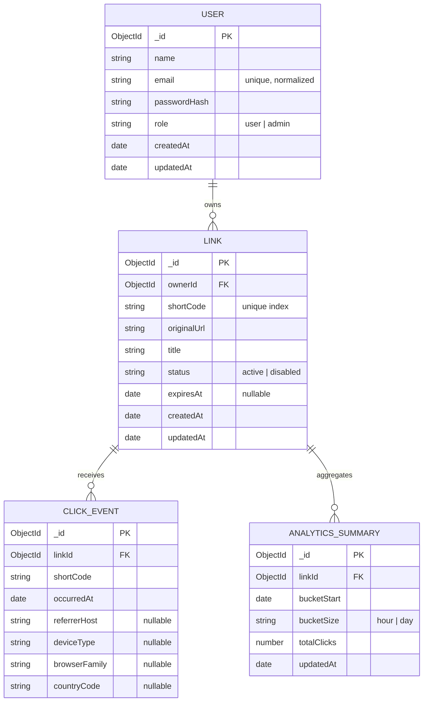

### 5.2 Indexes

#### `users` collection
| Index | Fields | Type |
|-------|--------|------|
| Email lookup | `{ email: 1 }` | Unique |

#### `links` collection
| Index | Fields | Type | Purpose |
|-------|--------|------|---------|
| Redirect lookup | `{ shortCode: 1 }` | Unique | Hot path: O(log n) code resolution |
| Dashboard listing | `{ ownerId: 1, createdAt: -1 }` | Compound | Paginated user link list |
| Expiry cleanup | `{ expiresAt: 1 }` | TTL (optional) | Background document pruning |

> [!WARNING]
> MongoDB TTL deletion is **asynchronous** (runs every 60 seconds). Never rely on TTL as the correctness gate for expiry. The redirect resolver must always check `expiresAt` explicitly.

#### `click_events` collection
| Index | Fields | Type | Purpose |
|-------|--------|------|---------|
| Analytics by link | `{ linkId: 1, occurredAt: -1 }` | Compound | Per-link click history |
| Time-range scans | `{ occurredAt: -1 }` | Single | Global reporting |

#### `analytics_summaries` collection
| Index | Fields | Type | Purpose |
|-------|--------|------|---------|
| Upsert key | `{ linkId: 1, bucketStart: 1, bucketSize: 1 }` | Unique compound | Idempotent worker upserts |

### 5.3 Data Retention Strategy

| Collection | Retention | Mechanism |
|------------|-----------|-----------|
| `users` | Indefinite | Manual deletion on account closure |
| `links` | Indefinite (soft-deleted) | `status: disabled` before hard delete |
| `click_events` | 90 days (default) | TTL index on `occurredAt` |
| `analytics_summaries` | 2 years | TTL index on `updatedAt` |

---

## 6. Short Code Generation

### 6.1 Algorithm

```
1. Generate 6 cryptographically random bytes  → crypto.randomBytes(6)
2. Encode using Base62 alphabet [A-Za-z0-9]   → 8-character code
3. Attempt INSERT into MongoDB (unique index on shortCode)
4. On DuplicateKeyError (E11000):
     - Retry up to 5 times with a new random code
     - After 5 failures: return 503 (extremely unlikely in practice)
```

**Why not check-then-insert?** Two concurrent requests can both pass an existence check. The MongoDB unique index is the final authority — always use insert with conflict detection.

### 6.2 Alphabet & Collision Analysis

```
Alphabet size:  62 characters
Code length:    7 characters
Keyspace:       62^7 = 3,521,614,606,208 ≈ 3.5 trillion
```

At 50,000 new links/day, the keyspace is effectively inexhaustible for this scale.

### 6.3 Custom Aliases

```
Validation rules:
  - Allowed characters: [A-Za-z0-9_-]
  - Min length: 3 characters
  - Max length: 50 characters
  - Reserved words blocklist: api, health, admin, login, register,
    static, metrics, favicon, robots, sitemap, assets
  - Uniqueness enforced via same unique index as random codes
  - Stricter rate limit: max 10 custom aliases per user per hour
```

### 6.4 Sequence Diagram — Code Generation

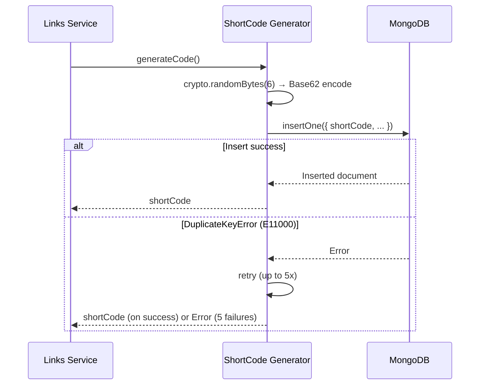

---

## 7. Redirect Flow (Critical Path)

This is the most latency-sensitive operation. Every millisecond counts.

### 7.1 Full Sequence

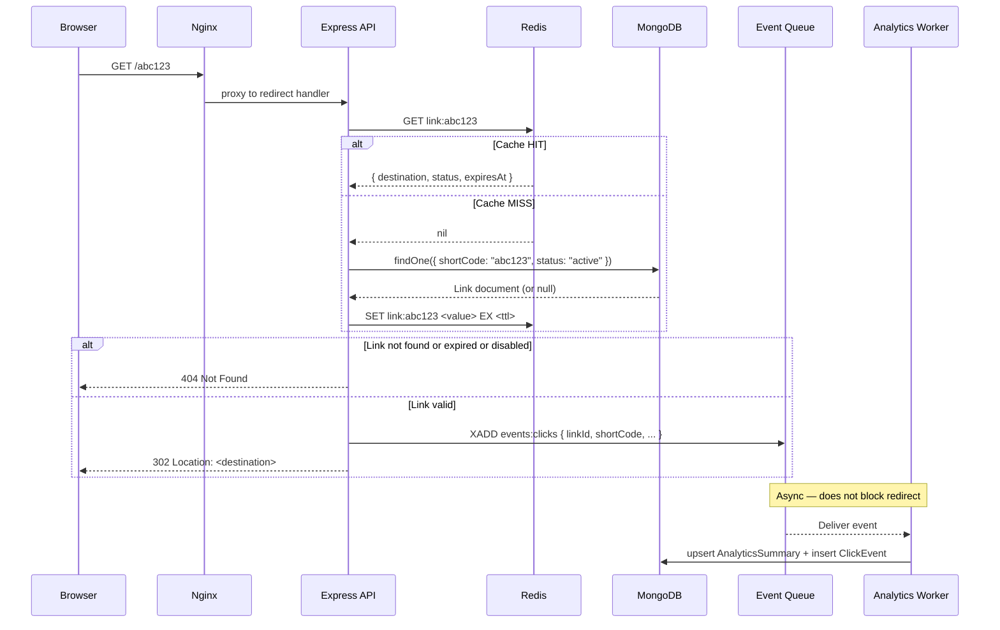

### 7.2 Redirect Response Codes

| Scenario | HTTP Status | Reason |
|----------|-------------|--------|
| Valid active link | `302 Found` | Default; prevents browser caching of old destinations |
| Unknown short code | `404 Not Found` | Do not reveal whether code ever existed |
| Expired link | `410 Gone` | Signals permanent unavailability |
| Disabled link | `404 Not Found` | Treat as not found for security |

> [!NOTE]
> `302` is chosen over `301` because `301` is permanently cached by browsers and CDNs. If a destination is later changed, all clients with a cached `301` will continue redirecting to the old URL — invisible and uncorrectable without clearing browser caches.

### 7.3 Expiry Validation Logic

```
resolve(shortCode):
  record ← cache.get(shortCode) or db.findByCode(shortCode)
  if record is null           → 404
  if record.status == disabled → 404
  if record.expiresAt != null
     and record.expiresAt < now() → 410
  → 302 to record.originalUrl
```

The cache TTL must never exceed the link's remaining lifetime:
```
cacheTTL = min(DEFAULT_TTL, record.expiresAt - now())
```

---

## 8. Caching Strategy

### 8.1 Cache Key Design

```
Key:   link:{shortCode}
Value: JSON { originalUrl, status, expiresAt }
TTL:   min(3600s, link.expiresAt - now())   // never outlive the link
```

### 8.2 Cache Lifecycle

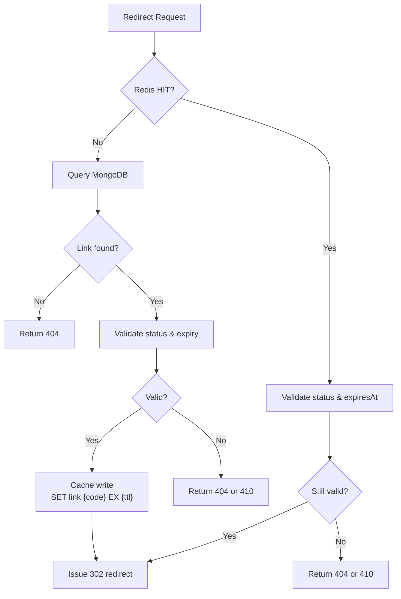

### 8.3 Cache Invalidation

| Event | Action |
|-------|--------|
| Link destination updated | `DEL link:{shortCode}` |
| Link disabled | `DEL link:{shortCode}` |
| Link deleted | `DEL link:{shortCode}` |
| Link expiry reached | Cache entry expires naturally (TTL ≤ expiresAt) |

> [!IMPORTANT]
> Cache invalidation must be **synchronous within the same transaction-equivalent operation** as the MongoDB write. Write to DB first, then invalidate cache. Failure to invalidate is handled by the natural TTL expiry.

### 8.4 Failure Modes

| Failure | Behavior |
|---------|----------|
| Redis unavailable | Fall back directly to MongoDB; log `cache.miss.redis_down` metric |
| Redis slow (>10ms) | Circuit-breaker: skip cache for duration of degradation |
| Stale cache entry | TTL-bounded; at most `DEFAULT_TTL` seconds of stale data |
| Cache stampede (popular link) | Probabilistic early expiry or single-flight coalescing |

---

## 9. Analytics Pipeline

### 9.1 Architecture

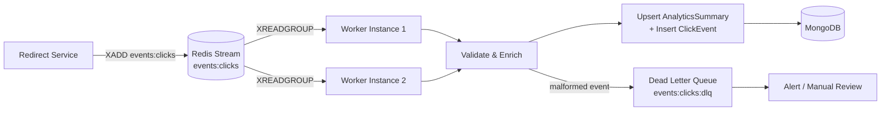

### 9.2 Click Event Schema

```typescript
interface ClickEvent {
  linkId:        string;      // ObjectId as string
  shortCode:     string;
  occurredAt:    string;      // ISO 8601 UTC
  referrerHost:  string | null;
  deviceType:    "mobile" | "tablet" | "desktop" | "bot" | null;
  browserFamily: string | null;
  countryCode:   string | null;  // ISO 3166-1 alpha-2
  // Note: no raw IP address stored
}
```

### 9.3 Worker Processing Contract

1. **Read** event from Redis Stream using consumer group (`XREADGROUP`).
2. **Validate** schema; drop + DLQ on validation failure.
3. **Upsert** `AnalyticsSummary` for `hour` and `day` buckets atomically.
4. **Insert** `ClickEvent` document.
5. **Acknowledge** (`XACK`) only after both DB writes succeed.
6. On DB failure: retry with exponential backoff (100ms, 200ms, 400ms, 800ms, 1600ms).
7. After 5 failures: `XACK` + write to DLQ; emit `worker.event.failed` metric.

### 9.4 Idempotency

Using `upsert: true` with `$inc`:

```javascript
db.analyticsSummaries.findOneAndUpdate(
  { linkId, bucketStart, bucketSize },
  { $inc: { totalClicks: 1 }, $set: { updatedAt: new Date() } },
  { upsert: true }
)
```

If the worker re-processes an event (e.g., after a crash before `XACK`), the `ClickEvent` insert will create a duplicate. To avoid double-counting, store the event's Redis stream ID in `ClickEvent` and use a unique index on it, or rely on idempotent upsert for summaries and accept rare duplicate raw events.

---

## 10. API Design

### 10.1 Conventions

- All management APIs versioned under `/api/v1`
- JSON request and response bodies
- Authentication via `Authorization: Bearer <jwt>`
- Consistent error envelope:
  ```json
  {
    "success": false,
    "error": {
      "code": "LINK_NOT_FOUND",
      "message": "No link found with the given ID",
      "requestId": "req_01HXY..."
    }
  }
  ```
- Paginated lists use `?page=1&limit=20`
- All timestamps in ISO 8601 UTC

### 10.2 Endpoint Reference

#### Authentication

| Method | Path | Auth | Description |
|--------|------|------|-------------|
| `POST` | `/api/v1/auth/register` | None | Create account |
| `POST` | `/api/v1/auth/login` | None | Issue JWT tokens |
| `POST` | `/api/v1/auth/logout` | Required | Invalidate refresh token |
| `POST` | `/api/v1/auth/refresh` | Refresh token | Rotate access token |
| `GET` | `/api/v1/auth/me` | Required | Get current user profile |

#### Link Management

| Method | Path | Auth | Description |
|--------|------|------|-------------|
| `POST` | `/api/v1/links` | Required | Create short link |
| `GET` | `/api/v1/links` | Required | List own links (paginated) |
| `GET` | `/api/v1/links/:id` | Required | Get single link details |
| `PATCH` | `/api/v1/links/:id` | Required | Update title / destination / expiry |
| `PATCH` | `/api/v1/links/:id/status` | Required | Enable or disable |
| `DELETE` | `/api/v1/links/:id` | Required | Delete link |

#### Redirect (Public)

| Method | Path | Auth | Description |
|--------|------|------|-------------|
| `GET` | `/:code` | None | Resolve code and redirect |

#### Analytics

| Method | Path | Auth | Description |
|--------|------|------|-------------|
| `GET` | `/api/v1/links/:id/analytics` | Required | Per-link click stats |
| `GET` | `/api/v1/analytics/overview` | Required | Account-level summary |

#### Operations

| Method | Path | Auth | Description |
|--------|------|------|-------------|
| `GET` | `/health/live` | None | Liveness probe |
| `GET` | `/health/ready` | None | Readiness probe (checks DB + Redis) |
| `GET` | `/metrics` | IP allowlist | Prometheus scrape endpoint |

### 10.3 Rate Limiting

| Endpoint Group | Limit | Window | Key |
|---------------|-------|--------|-----|
| `POST /auth/register` | 5 | 1 hour | IP |
| `POST /auth/login` | 10 | 15 min | IP |
| `POST /links` (random code) | 100 | 1 hour | User ID |
| `POST /links` (custom alias) | 10 | 1 hour | User ID |
| `GET /:code` (redirect) | 1000 | 1 min | IP |

---

## 11. Security Design

### 11.1 Authentication & Authorization

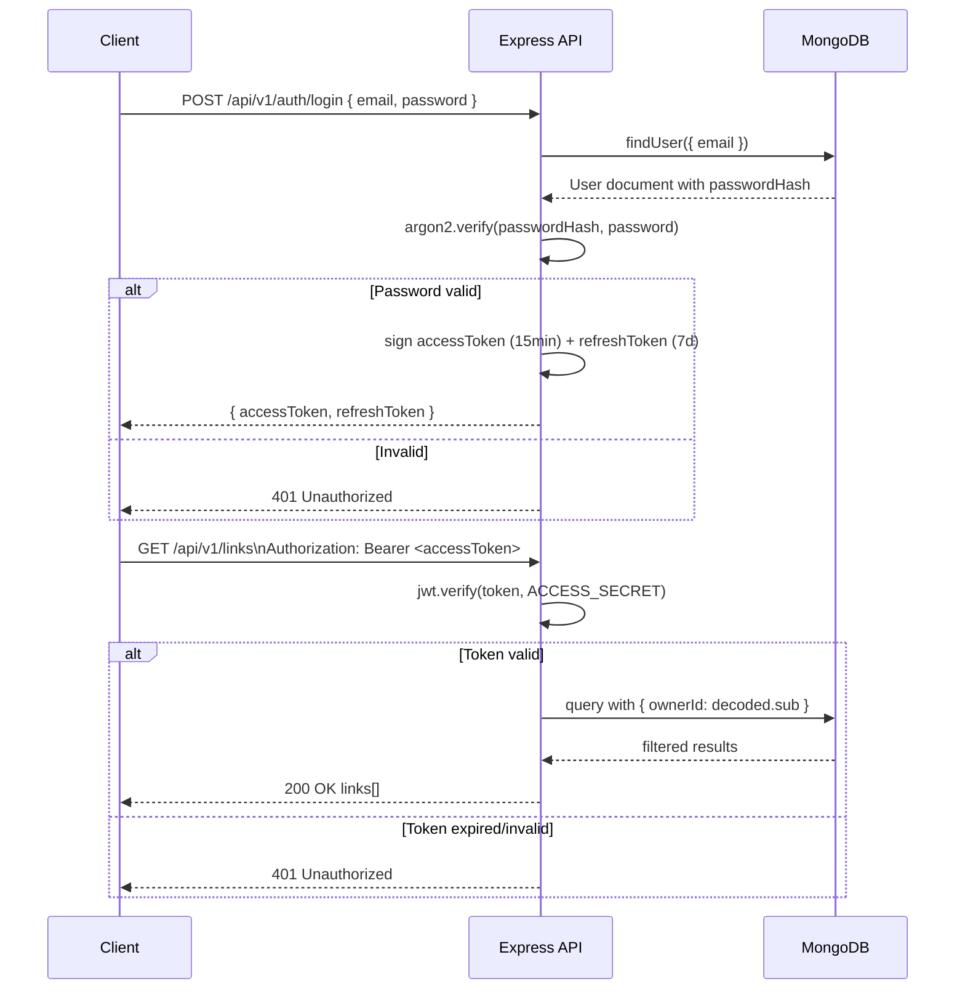

### 11.2 Security Controls Matrix

| Threat | Control |
|--------|---------|
| Weak passwords | Argon2id with tuned work factor (time=3, mem=65536) |
| Credential stuffing | Rate limiting on login + account lockout after N failures |
| Token theft | Short-lived access tokens (15 min); refresh token rotation |
| Stored XSS | CSP headers; React auto-escaping |
| CSRF | SameSite=Strict cookie attribute; CSRF token for state changes |
| SSRF | No server-side URL fetching in redirect path; blocklist private CIDRs if preview added |
| URL injection | Scheme allowlist: `http`, `https` only; reject `javascript:`, `data:`, `file:` |
| SQL/NoSQL injection | Parameterized queries via Mongoose; never string interpolation |
| Secret exposure | Secrets in env vars only; never in Git; never in Next.js `NEXT_PUBLIC_*` |
| Container escape | Non-root container user; read-only filesystem where possible |
| Network exposure | MongoDB and Redis ports bound to Docker internal network only |
| Dependency vulnerabilities | `npm audit` + Trivy image scan in CI |

### 11.3 CORS Configuration

```typescript
cors({
  origin: [process.env.PUBLIC_APP_URL],  // explicit allowlist
  credentials: true,
  methods: ["GET", "POST", "PATCH", "DELETE"],
  allowedHeaders: ["Content-Type", "Authorization"],
})
```

---

## 12. Reliability & Fault Tolerance

### 12.1 Failure Mode Analysis

| Component | Failure | Impact | Mitigation |
|-----------|---------|--------|------------|
| Redis | Unavailable | Cache misses; all reads hit MongoDB | Fallback to MongoDB; circuit breaker |
| MongoDB | Unavailable | Total outage for all write operations | Retry with timeout; return 503 |
| Analytics Worker | Crash | Events queue up in Redis Stream | Automatic restart (Docker); DLQ for unprocessable |
| Analytics Queue | Full | Event publishing fails | Drop event (analytics is non-critical); log metric |
| Nginx | Unavailable | Total outage | Restart policy; health check in CD pipeline |
| EC2 Instance | Terminated | Total outage | Documented rollback; snapshots; future: ALB + multi-instance |

### 12.2 Graceful Shutdown Sequence

```
SIGTERM received
  │
  ├── Stop accepting new HTTP requests (server.close())
  ├── Drain in-flight requests (wait up to 30s)
  ├── Stop publishing new events to queue
  ├── Close MongoDB connection pool
  ├── Close Redis connection
  └── Exit(0)
```

### 12.3 Health Check Contracts

**`GET /health/live`** — Is the process alive?
```json
{ "status": "ok", "uptime": 3600 }
```
Returns `200` always (if process is running). Returns `503` only if the process is in shutdown.

**`GET /health/ready`** — Can the process serve traffic?
```json
{
  "status": "ready",
  "checks": {
    "mongodb": "ok",
    "redis": "ok"
  }
}
```
Returns `200` only when both MongoDB and Redis are reachable. Returns `503` otherwise. CD pipeline must gate traffic switch on this endpoint.

### 12.4 Timeout Budget (Redirect Path)

| Step | Budget |
|------|--------|
| Redis GET | 5 ms |
| MongoDB findOne | 20 ms |
| Redis SET (async, non-blocking) | — |
| Event publish to queue | 5 ms (fire-and-forget) |
| **Total redirect p99 target** | **< 50 ms (cache hit) / < 200 ms (miss)** |

---

## 13. Observability

### 13.1 Key Metrics

| Metric Name | Type | Labels | Why It Matters |
|-------------|------|--------|----------------|
| `http_requests_total` | Counter | `method`, `route`, `status` | Traffic volume and error rate |
| `http_request_duration_ms` | Histogram | `method`, `route` | Latency percentiles (p50, p95, p99) |
| `redirect_total` | Counter | `result` (hit/miss/not_found/expired) | Core service usage |
| `cache_operations_total` | Counter | `operation` (hit/miss/set/del) | Cache effectiveness |
| `cache_hit_ratio` | Gauge | — | Derived: hits / (hits + misses) |
| `mongo_operation_duration_ms` | Histogram | `collection`, `operation` | DB performance |
| `analytics_queue_depth` | Gauge | — | Processing backlog |
| `analytics_events_processed_total` | Counter | `result` (success/failed/dlq) | Worker health |
| `worker_processing_duration_ms` | Histogram | — | Worker throughput |
| `process_cpu_seconds_total` | Counter | — | Infrastructure capacity |
| `process_resident_memory_bytes` | Gauge | — | Infrastructure capacity |

> [!CAUTION]
> Never use high-cardinality values as labels (e.g., raw short codes, user IDs, URLs). Cardinality explosion will crash Prometheus.

### 13.2 Alerting Rules (Recommended)

| Alert | Condition | Severity |
|-------|-----------|----------|
| High error rate | `error_rate > 1%` for 5 min | Critical |
| High redirect latency | `p99 > 200ms` for 3 min | Warning |
| Cache hit ratio low | `cache_hit_ratio < 0.80` for 10 min | Warning |
| Queue depth high | `queue_depth > 10000` for 5 min | Warning |
| Worker failures | `dlq_events > 0` in 5 min | Warning |
| Health check failing | `/health/ready` returns non-200 | Critical |

### 13.3 Structured Log Format

```json
{
  "timestamp": "2026-11-16T10:00:00.000Z",
  "level": "info",
  "requestId": "req_01HXY8ZAB3CDEF",
  "method": "GET",
  "path": "/abc123",
  "statusCode": 302,
  "durationMs": 12,
  "cacheResult": "hit",
  "userId": null,
  "service": "api"
}
```

**Never log:** passwords, tokens, session cookies, raw IP addresses, personally identifiable information.

### 13.4 Grafana Dashboard Panels

1. **Traffic Overview** — req/s, error rate, p50/p95/p99 latency
2. **Redirect Performance** — cache hit ratio, redirect count, latency histogram
3. **Database Health** — MongoDB operation latency, connection pool utilization
4. **Analytics Pipeline** — queue depth, events processed/s, DLQ count, worker latency
5. **Infrastructure** — CPU %, memory usage, disk I/O

---

## 14. Deployment Architecture

### 14.1 Initial AWS EC2 Architecture

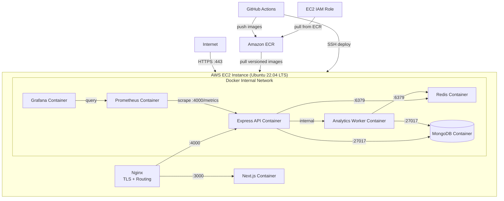

### 14.2 Docker Compose Service Map

```yaml
services:
  nginx:      # Public entry point; depends_on: web, api
  web:        # Next.js; PORT 3000; image: ecr/.../web:<sha>
  api:        # Express; PORT 4000; image: ecr/.../api:<sha>
  worker:     # Analytics; image: ecr/.../worker:<sha>
  redis:      # Redis 7; no public port binding
  mongodb:    # MongoDB 7; no public port binding; volume: mongo_data
  prometheus: # Prometheus; config from ./infra/prometheus.yml
  grafana:    # Grafana; volume: grafana_data
```

### 14.3 EC2 Security Group Rules

| Direction | Port | Source | Purpose |
|-----------|------|--------|---------|
| Inbound | 443 | 0.0.0.0/0 | HTTPS traffic |
| Inbound | 80 | 0.0.0.0/0 | HTTP → redirect to 443 |
| Inbound | 22 | Deployment IP only | SSH for CD pipeline |
| Outbound | All | 0.0.0.0/0 | ECR image pulls, package updates |
| **Blocked** | 27017 | All | MongoDB — Docker internal only |
| **Blocked** | 6379 | All | Redis — Docker internal only |
| **Blocked** | 9090 | All | Prometheus — Docker internal only |

### 14.4 Terraform Resource Map

```
infra/terraform/
├── main.tf           # Provider config
├── variables.tf      # Input variables
├── outputs.tf        # EC2 IP, ECR URL
├── ec2.tf            # Instance, key pair, user data
├── ecr.tf            # Repositories: web, api, worker
├── iam.tf            # EC2 instance role for ECR pull
├── sg.tf             # Security group rules
├── vpc.tf            # VPC, subnet, internet gateway
└── terraform.tfvars  # Non-secret variable values (committed)
```

---

## 15. CI/CD Pipeline

### 15.1 CI Pipeline (GitHub Actions — `ci.yml`)

Triggers: `push` and `pull_request` to `main`

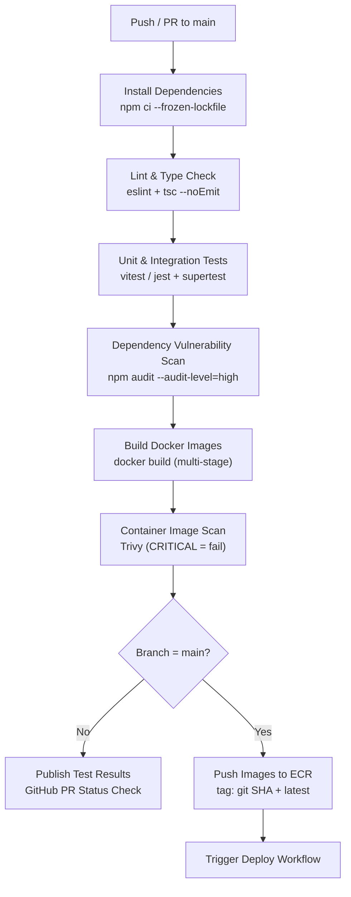

**Key CI rules:**
- Use `npm ci` with frozen lockfile — never `npm install` in CI
- Run tests in parallel where possible
- Fail fast on lint errors before spending time on build
- Never pass deployment secrets to PR-triggered jobs
- Use GitHub OIDC to authenticate with AWS (no long-lived IAM keys)

### 15.2 CD Pipeline (GitHub Actions — `deploy.yml`)

Triggers: completion of CI workflow on `main` branch

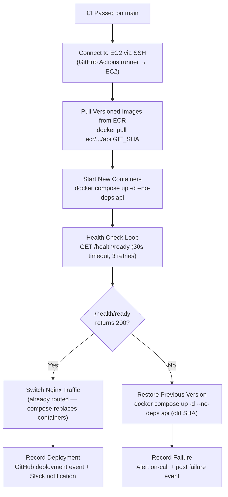

**Image tagging strategy:**
```
ecr.aws.../linkforge/api:git-abc1234   # immutable, per-commit
ecr.aws.../linkforge/api:latest         # floating, points to latest main
```

Always deploy using the git SHA tag. `latest` is for convenience only and must not be the deployment tag.

---

## 16. Scalability Roadmap

### 16.1 Current Bottlenecks (Single EC2)

| Bottleneck | Threshold | Resolution |
|------------|-----------|------------|
| Single EC2 instance | ~500 req/s sustained | Add load balancer + multiple API instances |
| MongoDB on same host | ~1000 write ops/s | Migrate to MongoDB Atlas (managed, replica set) |
| Redis on same host | ~100k ops/s | Migrate to ElastiCache (managed, persistent) |
| Analytics worker single-threaded | ~500 events/s | Multiple consumer group members |

### 16.2 Phase 1 → Production Evolution

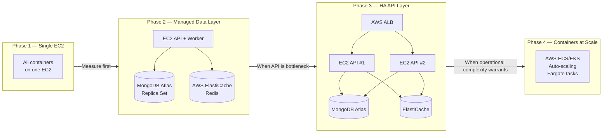

> [!TIP]
> Do not skip phases. Each phase is triggered by measured need, not anticipated load. Premature scaling adds cost and operational complexity without benefit.

### 16.3 Future Architecture Considerations

| Concern | Option | When to Consider |
|---------|--------|-----------------|
| Global redirect latency | CDN + edge workers (Cloudflare Workers) | When p99 > 100ms globally |
| Analytics at scale | Apache Kafka + ClickHouse | When click event volume > 10M/day |
| Multi-region | Route 53 latency routing + regional deployments | When users in multiple continents |
| Microservices | Extract redirect service independently | When redirect and management scale requirements diverge |
| Search & discovery | Elasticsearch for link search | When full-text search over link titles needed |

---

## 17. Engineering Trade-offs & ADRs

### ADR-001: Modular Monolith over Microservices

**Decision:** Build as a modular monolith (single API process with internal module boundaries).

**Rationale:**
- Simpler local development (one process to run)
- Easier distributed tracing (no service mesh needed)
- Single deployment unit reduces operational surface area
- Module boundaries are enforced by convention; extraction to services is straightforward later

**Trade-off:** Cannot scale individual modules independently until extracted.

---

### ADR-002: MongoDB over PostgreSQL

**Decision:** Use MongoDB as the primary database.

**Rationale:**
- Flexible document model suits variable link metadata
- Native TTL indexes for event retention
- Familiar for the Node.js ecosystem
- Atlas provides managed scaling path

**Trade-off:** Less suited for complex analytical queries and JOINs. Analytics summaries require deliberate aggregation design to stay performant.

---

### ADR-003: Redis Streams over Kafka for Analytics Queue

**Decision:** Use Redis Streams (or BullMQ over Redis) for the click event queue.

**Rationale:**
- Already a dependency for caching — no additional infrastructure
- Consumer groups provide at-least-once delivery
- Sufficient for initial throughput targets (<500 events/s)
- BullMQ adds UI visibility and retry management

**Trade-off:** Redis is not designed for log-scale event sourcing. At >10M events/day, consider Kafka.

---

### ADR-004: 302 over 301 for Redirects

**Decision:** Use HTTP `302 Found` as the default redirect status.

**Rationale:**
- `301 Moved Permanently` is cached indefinitely by browsers and CDNs
- If destination URL changes, users with cached `301` responses can never be corrected
- `302` forces re-resolution on each visit (tolerable with Redis cache)

**Trade-off:** Slightly higher server traffic than `301`; mitigated by Redis cache.

---

### ADR-005: No Raw IP Storage

**Decision:** Never store raw IP addresses in click event records.

**Rationale:**
- IP addresses are personal data under GDPR and similar regulations
- Country-level geolocation can be derived at ingestion time (using MaxMind or similar) without storing the source IP
- Reduces regulatory risk significantly

**Trade-off:** Cannot retrospectively geo-locate historical events if lookup DB changes.

---

### ADR-006: JWT with Short-Lived Access Tokens + Refresh Tokens

**Decision:** Issue 15-minute access tokens and 7-day refresh tokens.

**Rationale:**
- Short access token lifetime limits blast radius of token theft
- Refresh tokens enable long-lived sessions without long-lived secrets
- Stateless validation for access tokens (no DB lookup per request)
- Refresh token rotation on each use detects token reuse

**Trade-off:** Logout does not immediately invalidate access tokens. Requires a token blocklist (Redis set) for immediate invalidation on logout/compromise.

---

## Appendix A: Local Ports Reference

| Service | Local Port | Container Port |
|---------|------------|----------------|
| Next.js Frontend | 3000 | 3000 |
| Express API | 4000 | 4000 |
| MongoDB | — (internal only) | 27017 |
| Redis | — (internal only) | 6379 |
| Prometheus | 9090 (internal) | 9090 |
| Grafana | 3001 | 3000 |

## Appendix B: Environment Variables Reference

| Variable | Service | Purpose |
|----------|---------|---------|
| `NODE_ENV` | API, Worker | Runtime environment |
| `API_PORT` | API | HTTP listen port |
| `MONGODB_URI` | API, Worker | MongoDB connection string |
| `REDIS_URL` | API, Worker | Redis connection URL |
| `JWT_ACCESS_SECRET` | API | Signing key for access tokens |
| `JWT_REFRESH_SECRET` | API | Signing key for refresh tokens |
| `JWT_ACCESS_EXPIRY` | API | e.g. `15m` |
| `JWT_REFRESH_EXPIRY` | API | e.g. `7d` |
| `CACHE_DEFAULT_TTL` | API | Default Redis TTL in seconds |
| `RATE_LIMIT_WINDOW_MS` | API | Rate limit window |
| `LOG_LEVEL` | API, Worker | `debug`, `info`, `warn`, `error` |
| `METRICS_ENABLED` | API, Worker | Enable Prometheus endpoint |
| `PUBLIC_APP_URL` | API | CORS allowed origin |

---

*This document is the authoritative system design reference for LinkForge. Update it alongside significant architectural decisions. See `docs/decisions/` for individual Architecture Decision Records.*
